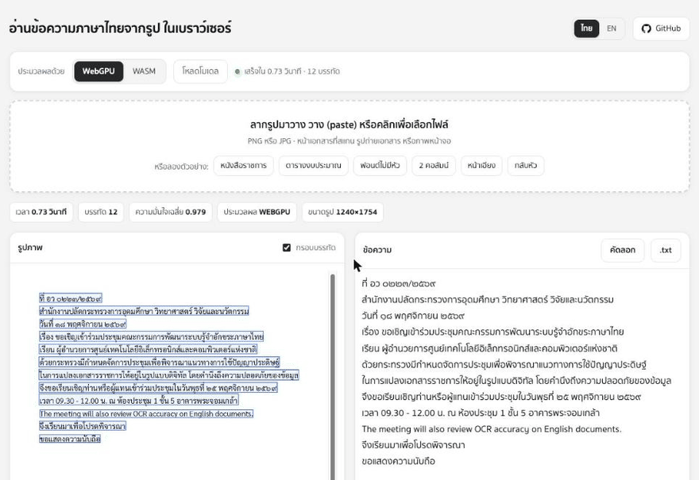
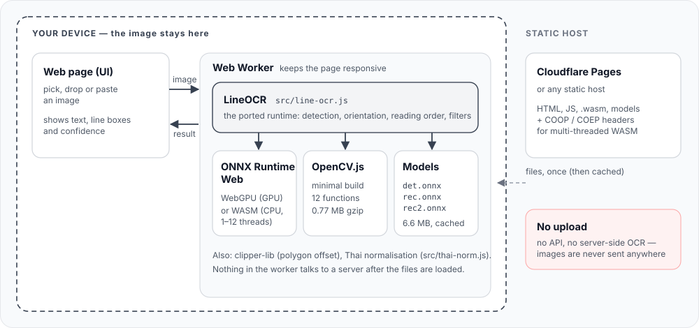
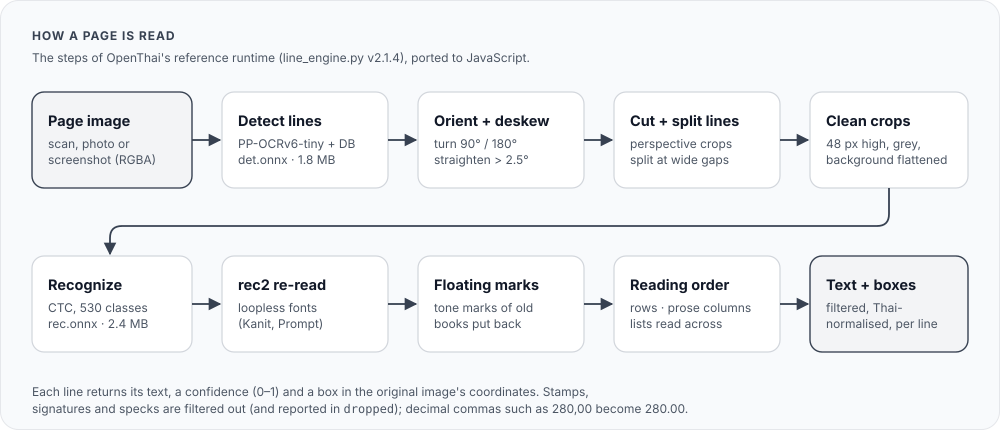
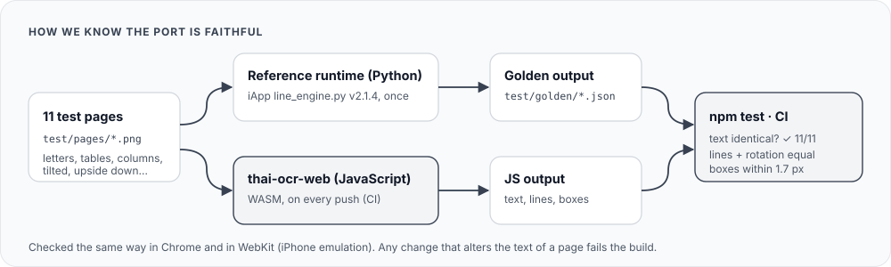

<div align="center">

# thai-ocr-web

**Thai + English OCR that runs entirely in your browser — images and PDFs.**<br>
WebGPU or WebAssembly · nothing is uploaded · works offline once loaded

[](https://thai-ocr-web.pages.dev/)
[](https://www.npmjs.com/package/thai-ocr-web)
[](https://huggingface.co/spaces/Riwara26/thai-ocr-web)
[](https://github.com/RiwRiwara/thai-ocr-web/actions/workflows/ci.yml)
[](LICENSE)


<a href="https://thai-ocr-web.pages.dev/"></a>

**[Try it now →](https://thai-ocr-web.pages.dev/)** &nbsp;·&nbsp; [on Hugging Face](https://huggingface.co/spaces/Riwara26/thai-ocr-web) &nbsp;·&nbsp; [ภาษาไทย](#ภาษาไทย)

</div>

---

thai-ocr-web is a JavaScript port of [OpenThai 2.1 OCR Text](https://huggingface.co/iapp/OpenThai2.1-OCR-Text-20261118),
iApp Technology's open Thai OCR model. The models run unchanged on [ONNX Runtime Web](https://onnxruntime.ai/), and the
model's whole reference runtime (`line_engine.py` v2.1.4) is ported to JavaScript — so on every test page **the output
is identical, character for character, to the reference Python runtime**, and CI checks it on every push.

> Unofficial port — not affiliated with or endorsed by iApp Technology.

## Why

- **Private by design.** Scans of IDs, contracts and medical letters never leave the device. No server to run or pay for.
- **Accurate Thai.** The model averages **88.3** character accuracy on iApp's 12 printed Thai test sets — Tesseract gets 75.4.
- **Fast.** ~0.2–0.4 s a page with WebGPU on a Mac mini; WASM works everywhere else.
- **The full pipeline, not just the model.** Page orientation (90° / 180°), deskew, column-aware reading order, a second
  recognizer for loopless fonts (Kanit, Prompt), floating tone marks of old books, Thai normalisation, decimal commas,
  and a filter for stamps and signatures — with a box and a confidence for every line.
- **Small.** 6.6 MB of models and a custom OpenCV.js build of 0.77 MB (gzip), 5× smaller than the stock one.

## What you can build with it

- **Private document intake.** Read ID cards, contracts, bank statements or medical letters in the user's own browser.
  The file never reaches your server, which helps with PDPA and internal data rules (banks, hospitals, government).
- **Fill a form from a photo.** OCR an invoice, receipt or application form, then pick out the fields (tax ID, dates,
  amounts) with your own rules or an LLM. Each line comes with a box and a confidence, so low-confidence fields can be
  sent to a person to check.
- **Cheaper, safer LLM pipelines.** Read the page locally and send the LLM text instead of an image: fewer tokens, and
  you can remove personal data before anything leaves the device.
- **Search old scans.** Turn a folder of scanned PDFs (theses, court papers, archives) into searchable text, page by
  page, with no OCR server to run or pay for.
- **Offline field apps.** A PWA for inspectors, logistics or clinics keeps working without a signal once the models
  are cached.
- **Browser extensions and accessibility.** Copy Thai text out of screenshots and images on any page, or read it out
  for screen-reader users.
- **Server side too.** The core API runs in Node (the parity test does), for batch jobs on a machine you already have.

Printed text only: handwriting needs a different model, and tables come out as text row by row.

## How it compares

Character accuracy (100 × (1 − CER)), average of 12 printed Thai sets, from
[iApp's model card](https://huggingface.co/iapp/OpenThai2.1-OCR-Text-20261118) (higher is better):

| Engine | Accuracy | Runs in the browser |
|---|---|---|
| Typhoon OCR V2 2B | 89.6 | ✗ (GPU server) |
| **OpenThai 2.1 OCR Text — this project** | **88.3** | **✓ WebGPU / WASM** |
| Gemini 2.5 Flash | 87.1 | ✗ (cloud API) |
| Google Cloud Vision | 83.6 | ✗ (cloud API) |
| PaddleOCR PP-OCRv5 (Thai) | 81.1 | ✓ (PaddleOCR.js) |
| Tesseract 5 (tha+eng) | 75.4 | ✓ (Tesseract.js) |

These are iApp's numbers for the Python runtime; this port gives the same text on every page of its own test set.

## Performance

Mac mini (Apple Silicon), Edge 154, the 11 test pages, warm:

| Backend | ms / page (mean) | range |
|---|---|---|
| **WebGPU** (Metal) | **200** | 118–379 |
| WASM, 12 threads | 323 | 167–702 |
| WASM, 4 threads (default) | 380 | 190–878 |
| WASM, 1 thread | 768 | 346–1891 |

Pages that need turning take the upper end. The first page after loading WebGPU is slower (~1 s, shader compilation).
**First load** (gzip): models 6.6 MB + OpenCV.js 0.77 MB + ONNX Runtime 3.9 MB (WASM) or 7.3 MB (WebGPU); cached after that.

## Use it

### In the browser

```bash
npm install thai-ocr-web onnxruntime-web
```

Serve the files in `node_modules/thai-ocr-web/models/` from your site (e.g. copy them to `public/models/`), then:

```js
import { createThaiOCR } from "thai-ocr-web/browser";

const ocr = await createThaiOCR({
  modelBaseUrl: "/models/",
  backend: "webgpu",          // falls back to WASM when the device has no WebGPU
});

const result = await ocr.read(ctx.getImageData(0, 0, width, height));
result.text;       // the page's text in reading order
result.lines;      // [{ text, confidence, row, box: [[x, y] × 4] }] in image coordinates
result.dropped;    // lines filtered out (stamps, signatures, specks) and why
result.rotation;   // 0 / 90 / 180 / 270 if the page was turned
```

Run it in a Web Worker to keep the page responsive — copy [`demo/ocr.worker.js`](demo/ocr.worker.js) (it also shows the
two guards a worker needs for WebKit and for ONNX Runtime's thread workers). For multi-threaded WASM, serve the page
with `Cross-Origin-Opener-Policy: same-origin` and `Cross-Origin-Embedder-Policy: require-corp`; without them it runs
on one thread.

### PDFs

Install [pdf.js](https://github.com/mozilla/pdf.js) as well (`npm install pdfjs-dist`). `readPdf` goes through the
pages one by one: a page that already carries text (a PDF exported from Word, a page saved as PDF) gives that text
directly — exact and instant — and a scanned page is rendered and read with OCR.

```js
import { readPdf } from "thai-ocr-web/pdf";
import workerSrc from "pdfjs-dist/build/pdf.worker.min.mjs?url";   // Vite; any URL of pdf.worker.min.mjs works

for await (const page of readPdf(file, { read: (image) => ocr.read(image), workerSrc })) {
  page.pageNumber;   // 1, 2, …
  page.source;       // "text-layer" (the PDF's own text) or "ocr"
  page.text;
  page.result;       // the full OCR result for "ocr" pages
}
```

Options: `useTextLayer: false` OCRs every page; `maxPages`, `signal` (AbortSignal), `onPage` for progress,
`targetLongSide` (render size, default 2200 px), and `documentOptions` for pdf.js — for scanned PDFs with JBIG2 or
JPEG 2000 images, and for PDFs without embedded fonts, serve pdf.js's `wasm/`, `cmaps/` and `standard_fonts/` folders
and pass `{ wasmUrl, cMapUrl, cMapPacked: true, standardFontDataUrl }` (the demo does this). A text layer whose Thai
characters did not survive (unmapped glyphs, broken mark order) is not trusted: that page is OCR'd instead.

### Node.js and the command line

```bash
npm install -g thai-ocr-web onnxruntime-node pdfjs-dist @napi-rs/canvas
thai-ocr-web scan.png                    # text to stdout
thai-ocr-web contract.pdf --json         # text, lines, boxes and confidence
thai-ocr-web ./scans -r -o ./text        # a folder, one .txt per file
```

`onnxruntime-node` runs the models natively (about 0.5 s a page on 8 CPU threads); without it the CLI falls back to
the WASM build on one thread. `pdfjs-dist` reads PDFs and `@napi-rs/canvas` renders their scanned pages; install
`sharp` to read WebP, TIFF or HEIC. All of these are optional. In code:

```js
import { createThaiOCR, readImageFile, readPdfFile } from "thai-ocr-web/node";

const ocr = await createThaiOCR();                       // models load from the package itself
const { text, lines } = await ocr.read(await readImageFile("scan.jpg"));
for await (const page of readPdfFile(ocr, "doc.pdf")) console.log(page.pageNumber, page.source, page.text);
```

The Node entry gives the same text as the reference runtime on every test page too (`npm test`).

### Core API (any JavaScript runtime)

`LineOCR` takes its dependencies as arguments, so it also runs in Node or a custom setup:

```js
import { LineOCR } from "thai-ocr-web";

const ocr = await LineOCR.create({
  ort,          // onnxruntime-web
  cv,           // OpenCV.js — `await (await import("thai-ocr-web/vendor/opencv/opencv-ocr.mjs")).default()`
  ClipperLib,   // clipper-lib
  loadFile: async (name) => bytesOf(`models/${name}`),
  overrides: { join: { paragraphs: true } },   // optional, same keys as the Python runtime
});
```

[`test/parity.mjs`](test/parity.mjs) is a complete Node example. TypeScript types are included.

## Browser support

| Browser | WebGPU | WASM | Checked |
|---|---|---|---|
| Chrome / Edge (desktop) | ✓ | ✓ multi-thread | Edge 154 on macOS, Chrome on Linux |
| Safari / any browser on iPhone, iPad | — | ✓ one thread, 512 MB | WebKit with iPhone 15 Pro emulation |
| Firefox | Windows, Apple Silicon | ✓ | not yet |

WebGPU availability varies by browser, OS and GPU; the library falls back to WASM on its own. On iPhone and iPad it
uses one thread and caps ONNX Runtime's WASM memory at 512 MB (`maxMemoryMB`): the runtime otherwise reserves 4 GB up
front, which iOS refuses with "RangeError: Out of memory". All test pages read within 320 MB.

## How it works

<p align="center"></p>

<p align="center"></p>

| Path | What |
|---|---|
| `src/line-ocr.js` | the runtime: detection, recognition, orientation, reading order, filters |
| `src/thai-norm.js` | Thai canonical form (mark order, sara am, legacy code points) |
| `src/browser.js` | `createThaiOCR()`: loads ONNX Runtime Web, OpenCV.js and the models (cached) |
| `src/node.js`, `bin/` | `thai-ocr-web/node` and the `thai-ocr-web` command (onnxruntime-node) |
| `src/pdf.js` | `readPdf()`: a PDF's own text where it has one, OCR for scanned pages (pdf.js) |
| `vendor/opencv/` | the minimal OpenCV.js build and the script that rebuilds it |
| `models/` | OpenThai 2.1 OCR Text models (v2.1.4), unchanged |
| `demo/` | the demo site (Vite) |
| `test/` | test pages, the reference runtime's outputs, the parity test |

## Faithful to the reference

<p align="center"></p>

## Development

```bash
npm install
npm run dev        # demo at http://localhost:5173
npm test           # parity with the reference runtime (11 pages; WASM, and onnxruntime-node) + PDFs
npm run build      # static site in dist/
```

The live demo is on Cloudflare Pages, connected to this repository: every push to `main` is built and deployed.
Cloudflare limits a file to 25 MiB, so the build splits ONNX Runtime's ~29 MB WebGPU runtime into parts
(`scripts/split-large-assets.mjs`) that the page joins again (`createThaiOCR({ wasmManifestUrl })`). On hosts that cannot
send COOP/COEP headers (GitHub Pages) the bundled [coi-serviceworker](https://github.com/gzuidhof/coi-serviceworker)
adds them.

<details>
<summary>Rebuilding the minimal OpenCV.js</summary>

Only needed if `src/line-ocr.js` starts calling a new OpenCV function (add its name to
`vendor/opencv/build/whitelist.json`):

```bash
git clone --depth 1 https://github.com/emscripten-core/emsdk.git && (cd emsdk && ./emsdk install latest && ./emsdk activate latest)
source emsdk/emsdk_env.sh
git clone --depth 1 --branch 5.0.0 https://github.com/opencv/opencv.git
OPENCV_SRC=$PWD/opencv npm run build:opencv && npm test
```

OpenCV's own build tool is a Python script, so this step needs Python 3 and CMake; nothing else does.
</details>

## FAQ

**Is anything uploaded?** No. The page downloads the models once; the image is read on your device.<br>
**Does it read handwriting?** No — printed text only. Handwritten parts of a page are left out.<br>
**Tables?** Cells are read row by row as text; table structure is not kept (iApp's OCR Markdown model does that).<br>
**PDFs?** Yes — `thai-ocr-web/pdf` (see [PDFs](#pdfs)); the demo opens them too.<br>
**Can I use only the `.onnx` files?** You can, but on their own they give raw tensors: a probability map and per-position
character scores. Turning that into text is the work this package does — finding lines (DB post-processing, Clipper),
cutting and straightening crops, CTC decoding, the second recogniser for loopless fonts, orientation, reading order and
filters. Use the package, or [`src/line-ocr.js`](src/line-ocr.js) as the reference if you port it elsewhere.<br>
**Why is my first page slower?** Model and runtime download (cached afterwards) and, with WebGPU, shader compilation.

## Roadmap

- [x] PDF input (pdf.js)
- [x] npm package
- [x] Node.js and a command-line tool
- [ ] Searchable-PDF output (text layer over scanned pages)
- [ ] Word boxes (the reference runtime's `words`)
- [ ] Several workers for batches of pages
- [ ] More real-world test pages

Ideas and bug reports are welcome — see [CONTRIBUTING.md](CONTRIBUTING.md).

## Limits (of the model)

Printed text only. Heavily decorative fonts can be misread, stamps come out as text, Thai digits occasionally come out
as Arabic digits. The test pages here are synthetic; check it on your own documents.

## License and credits

Apache-2.0 — see [LICENSE](LICENSE) and [NOTICE](NOTICE).

- Models and reference runtime: [OpenThai 2.1 OCR Text](https://huggingface.co/iapp/OpenThai2.1-OCR-Text-20261118),
  iApp Technology (Apache-2.0), built on PaddlePaddle PP-OCRv6-tiny (Apache-2.0).
- [OpenCV](https://opencv.org/) (Apache-2.0), [ONNX Runtime Web](https://onnxruntime.ai/) (MIT),
  [Clipper](https://www.npmjs.com/package/clipper-lib) (Boost), [pdf.js](https://github.com/mozilla/pdf.js) (Apache-2.0, optional),
  [coi-serviceworker](https://github.com/gzuidhof/coi-serviceworker) (MIT, demo only).

---

## ภาษาไทย

**OCR ภาษาไทย + อังกฤษ ที่รันใน browser ทั้งหมด** ผ่าน WebGPU หรือ WebAssembly ไม่มี server รูปไม่ออกจากเครื่อง

พอร์ตโมเดล [OpenThai 2.1 OCR Text](https://huggingface.co/iapp/OpenThai2.1-OCR-Text-20261118) ของ iApp Technology
(Apache-2.0) มาเป็น JavaScript ทั้ง pipeline ผลลัพธ์**ตรงกับ runtime Python ต้นฉบับทุกตัวอักษร**ในทุกหน้าทดสอบ (`npm test`)

- **ลองเลย:** <https://thai-ocr-web.pages.dev/> หรือบน Hugging Face <https://huggingface.co/spaces/Riwara26/thai-ocr-web> — มีปุ่มตัวอย่างให้กดได้ทันที
- **เร็ว:** ประมาณ 0.2–0.4 วินาที/หน้า ด้วย WebGPU บน Mac mini และใช้ WASM ได้ทุก browser รวม iPhone
- **ครบ:** หมุนหน้า 90°/180°, แก้เอียง, อ่านทีละคอลัมน์, ฟอนต์ไม่มีหัว (Kanit/Prompt), วรรณยุกต์ลอยของหนังสือเก่า, ทศนิยมคอมมา, กรองตราประทับ
- **PDF:** หน้าที่มีข้อความอยู่ในไฟล์แล้วดึงข้อความตรง ๆ หน้าที่เป็นภาพสแกนจะ OCR ให้ (`thai-ocr-web/pdf`)
- **ใช้บน Node / command line:** `npm i -g thai-ocr-web onnxruntime-node pdfjs-dist @napi-rs/canvas` แล้วสั่ง `thai-ocr-web scan.pdf` ได้เลย (อ่านทั้งโฟลเดอร์ได้ด้วย `-r -o ./text`)
- **ใช้ในแอป:** `npm install thai-ocr-web onnxruntime-web` แล้วใช้ `createThaiOCR()` จาก `thai-ocr-web/browser` (ดูตัวอย่างด้านบน)
- **ใช้แค่ไฟล์โมเดลได้ไหม:** ได้ แต่ไฟล์ `.onnx` ให้ผลเป็นตัวเลขดิบ ต้องมีขั้นตอนก่อนและหลัง (หาบรรทัด ตัดภาพ ถอดรหัส CTC เรียงลำดับการอ่าน) ซึ่งก็คือสิ่งที่แพ็กเกจนี้ทำ
- **เอาไปทำอะไรได้:** รับเอกสารลูกค้าแบบไฟล์ไม่ออกจากเครื่อง (บัตรประชาชน สัญญา statement) · กรอกฟอร์มจากรูปใบแจ้งหนี้หรือใบเสร็จ ·
  OCR ในเครื่องก่อนแล้วส่งแค่ข้อความให้ LLM (ถูกกว่าและตัดข้อมูลส่วนตัวออกได้) · ทำให้ PDF สแกนเก่าค้นหาได้ · แอปภาคสนามที่ใช้ offline ·
  extension คัดลอกข้อความไทยจากรูป · งาน batch ฝั่ง Node
- **ข้อจำกัด:** อ่านตัวพิมพ์เท่านั้น ไม่เก็บโครงสร้างตาราง ควรทดสอบกับเอกสารจริงของคุณก่อนใช้งาน

เป็นงานพอร์ตอิสระ ไม่ได้เกี่ยวข้องหรือได้รับการรับรองจาก iApp Technology
