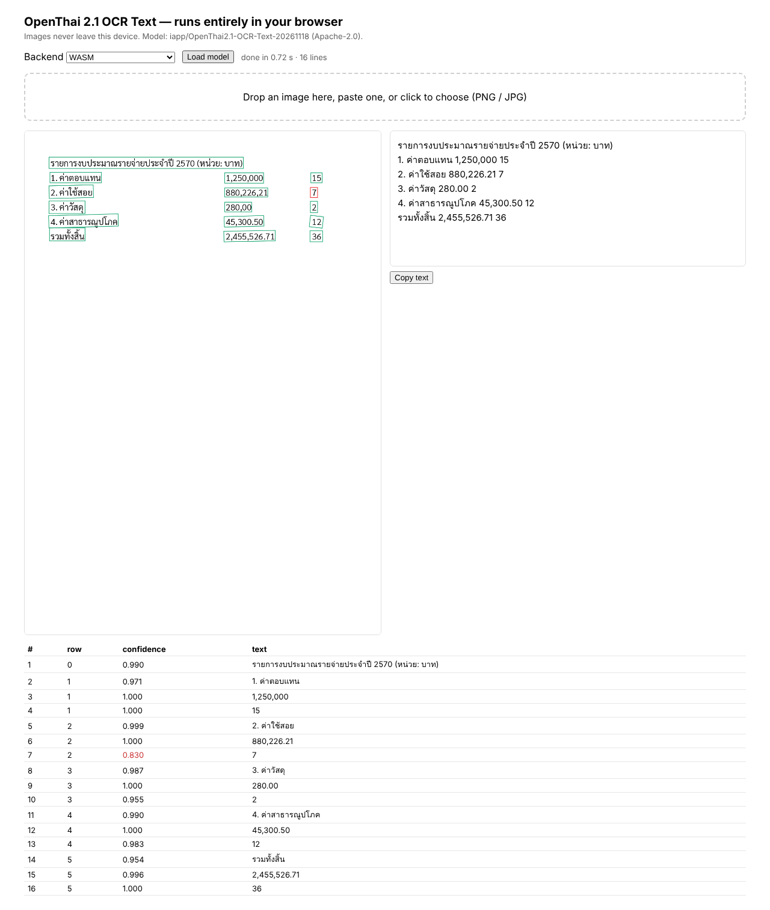

# thai-ocr-web

**Thai + English printed-text OCR that runs entirely in the browser** — WebGPU or WebAssembly, no server, the
image never leaves the device.

A JavaScript port of [OpenThai 2.1 OCR Text](https://huggingface.co/iapp/OpenThai2.1-OCR-Text-20261118) by
iApp Technology: the 6.6 MB models run unchanged on [ONNX Runtime Web](https://onnxruntime.ai/), and the whole
reference runtime (`line_engine.py` v2.1.4) is ported to JavaScript. **On every test page the output is identical,
character for character, to the reference Python runtime.**

> Unofficial port — not affiliated with or endorsed by iApp Technology.



## Highlights

- **Accurate.** Same text as the reference runtime on all 11 test pages (letters, tables, two columns, tilted,
  sideways, upside down, noisy JPEG, low resolution, dark and gradient backgrounds). The model itself scores
  88.3 character accuracy on iApp's 12 printed Thai sets, against 75.4 for Tesseract (iApp's model card).
- **Fast.** ~0.2 s a page with WebGPU, ~0.4 s with WASM on a Mac mini (Apple Silicon).
- **Private.** Everything runs on the user's device; works offline once the models are cached.
- **Complete pipeline.** Orientation (90° / 180°), deskew, column-aware reading order, a second recognizer for
  loopless fonts (Kanit, Prompt), floating tone marks of old books, Thai normalisation, decimal commas, and a
  filter for stamps and signatures — with a box and a confidence for every line.
- **Small.** 6.6 MB of models + a minimal OpenCV.js build (0.77 MB gzip, 5× smaller than the full one).

## Performance

Mac mini (Apple Silicon), Edge 154, 11 test pages, warm:

| Backend | ms / page (mean) | range |
|---|---|---|
| **WebGPU** (Metal) | **200** | 118–379 |
| WASM, 12 threads | 323 | 167–702 |
| WASM, 4 threads (default) | 380 | 190–878 |
| WASM, 1 thread | 768 | 346–1891 |

Pages that need turning (90° / 180°) take the upper end. The first page after loading WebGPU is slower (~1 s,
shader compilation).

**First load** (gzip): models 6.6 MB + OpenCV.js 0.77 MB + ONNX Runtime 3.9 MB (WASM) or 7.3 MB (WebGPU).
Models are cached with the Cache API, so later visits load in a fraction of a second.

## Quick start (demo)

```bash
npm install
npm run dev        # http://localhost:5173
```

Drop, paste or pick an image. `?backend=wasm` or `?threads=8` in the URL override the defaults.

```bash
npm run build      # static site in dist/
```

Host `dist/` anywhere static. For multi-threaded WASM the host must send
`Cross-Origin-Opener-Policy: same-origin` and `Cross-Origin-Embedder-Policy: require-corp`
(`demo/public/_headers` does this on Cloudflare Pages). Without them it still works, on one thread.

## Use it in your app

### Browser (recommended)

```js
import { createThaiOCR } from "thai-ocr-web/browser";

const ocr = await createThaiOCR({
  modelBaseUrl: "/models/",   // serve the files of models/ here
  backend: "webgpu",          // falls back to WASM when the device has no WebGPU
});

const result = await ocr.read(ctx.getImageData(0, 0, width, height));
result.text;       // the page's text in reading order
result.lines;      // [{ text, confidence, row, box: [[x, y] × 4] }] in image coordinates
result.dropped;    // lines filtered out (stamps, signatures, specks) and why
result.rotation;   // 0 / 90 / 180 / 270 if the page was turned
```

Run it in a Web Worker to keep the page responsive — see [`demo/ocr.worker.js`](demo/ocr.worker.js).

### Core API (any runtime)

`LineOCR` takes its dependencies as arguments, so it runs in a browser, a worker or Node:

```js
import { LineOCR } from "thai-ocr-web";

const ocr = await LineOCR.create({
  ort,          // onnxruntime-web
  cv,           // OpenCV.js (vendor/opencv/opencv-ocr.mjs or the full build)
  ClipperLib,   // clipper-lib
  loadFile: async (name) => bytesOf(`models/${name}`),
  executionProviders: ["wasm"],
  overrides: { join: { paragraphs: true } },   // optional, same keys as the Python runtime
});
```

See [`test/parity.mjs`](test/parity.mjs) for a complete Node example. TypeScript types are included.

## How it works

```
image ─▶ detector (PP-OCRv6-tiny, DB) ─▶ text-line boxes ─▶ orientation + deskew
      ─▶ line crops at 48 px, background flattened ─▶ recognizer (CTC) ─▶ rec2 for loopless fonts
      ─▶ floating marks re-attached ─▶ reading order (rows, prose columns, lists) ─▶ filter ─▶ text
```

| Path | What |
|---|---|
| `src/line-ocr.js` | the runtime: detection, recognition, orientation, reading order, filters |
| `src/thai-norm.js` | Thai canonical form (mark order, sara am, legacy code points) |
| `src/browser.js` | `createThaiOCR()`: loads ONNX Runtime Web, OpenCV.js, the models (cached) |
| `vendor/opencv/` | minimal OpenCV.js build and the script that rebuilds it |
| `models/` | the OpenThai 2.1 OCR Text models (v2.1.4), unchanged |
| `demo/` | the demo page (Vite) |
| `test/` | test pages, reference outputs from the Python runtime, parity test |

## Testing

```bash
npm test
```

reads every page in `test/pages` with ONNX Runtime Web (WASM, the browser's engine) and compares the result with
`test/golden/`, the output of the reference Python runtime (v2.1.4, ONNX Runtime backend). The test fails unless
the text is identical; box coordinates may differ by a pixel or two (OpenCV builds round differently). CI runs it
on every push.

## Limits (of the model)

Printed text only — handwriting reads poorly. No table structure (rows come out as lines of text; for tables,
iApp's OCR Markdown model is the tool). Heavily decorative fonts can be misread, stamps come out as text, Thai
digits occasionally come out as Arabic digits. The test pages here are synthetic; check it on your own documents.

## Rebuilding OpenCV.js

Only needed if `src/line-ocr.js` starts calling a new OpenCV function (add its name to
`vendor/opencv/build/whitelist.json`):

```bash
git clone --depth 1 https://github.com/emscripten-core/emsdk.git && (cd emsdk && ./emsdk install latest && ./emsdk activate latest)
source emsdk/emsdk_env.sh
git clone --depth 1 --branch 5.0.0 https://github.com/opencv/opencv.git
OPENCV_SRC=$PWD/opencv npm run build:opencv && npm test
```

(OpenCV's own build tool is a Python script, so this step needs Python 3 and CMake; nothing else does.)

## License and credits

Apache-2.0 — see [LICENSE](LICENSE) and [NOTICE](NOTICE).

- Models and reference runtime: [OpenThai 2.1 OCR Text](https://huggingface.co/iapp/OpenThai2.1-OCR-Text-20261118),
  iApp Technology (Apache-2.0), built on PaddlePaddle PP-OCRv6-tiny (Apache-2.0).
- [OpenCV](https://opencv.org/) (Apache-2.0), [ONNX Runtime Web](https://onnxruntime.ai/) (MIT),
  [Clipper](https://www.npmjs.com/package/clipper-lib) (Boost).

---

## ภาษาไทย

OCR ภาษาไทย + อังกฤษ (ตัวพิมพ์) ที่รันใน browser ทั้งหมด ผ่าน WebGPU หรือ WebAssembly ไม่มี server รูปไม่ออกจากเครื่องผู้ใช้
พอร์ตจากโมเดล OpenThai 2.1 OCR Text ของ iApp Technology (Apache-2.0) มาเป็น JavaScript ทั้ง pipeline
ผลลัพธ์ **ตรงกับ runtime Python ต้นฉบับทุกตัวอักษร** ในทุกหน้าทดสอบ (`npm test`)

- เร็ว: ~0.2 วินาที/หน้า (WebGPU) หรือ ~0.4 วินาที/หน้า (WASM) บน Mac mini
- ครบ: หมุนหน้า 90°/180°, แก้เอียง, อ่านทีละคอลัมน์, ฟอนต์ไม่มีหัว (Kanit/Prompt), วรรณยุกต์ลอยของหนังสือเก่า, ทศนิยมคอมมา, กรองตราประทับ
- ใช้: `npm install && npm run dev` สำหรับ demo หรือ `createThaiOCR()` จาก `thai-ocr-web/browser` ในแอปของคุณ
- ข้อจำกัด: อ่านตัวพิมพ์เท่านั้น ไม่เก็บโครงสร้างตาราง ควรทดสอบกับเอกสารจริงของคุณก่อนใช้งาน

เป็นงานพอร์ตอิสระ ไม่ได้เกี่ยวข้องหรือได้รับการรับรองจาก iApp Technology
